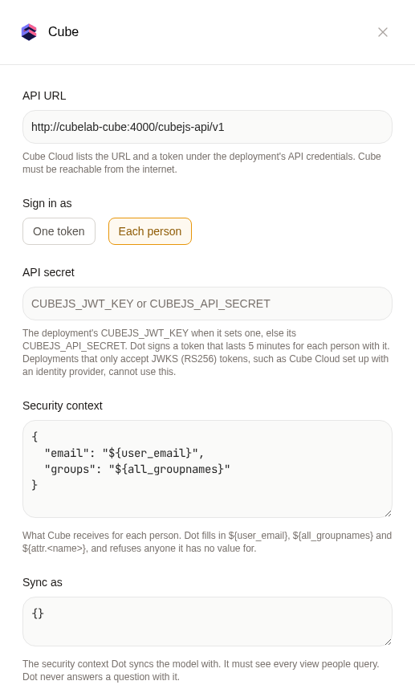
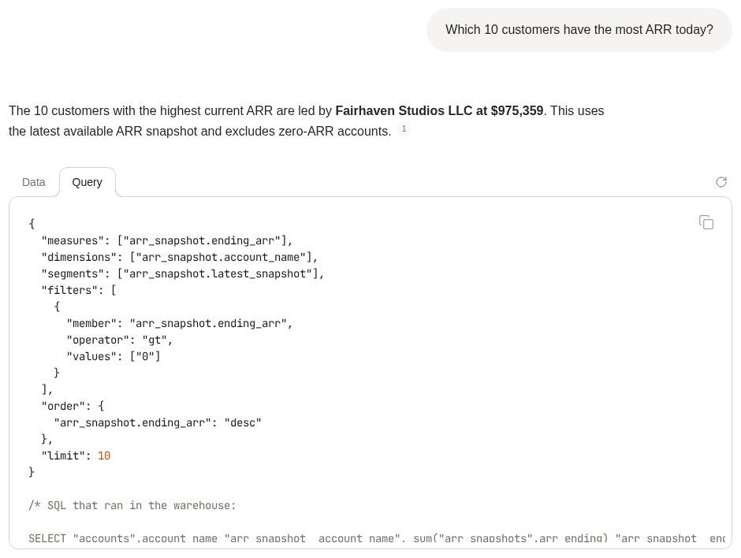

# Cube

If your team defines its metrics in [Cube](https://cube.dev), connect it to Dot. Dot then asks Cube instead of working out revenue from raw tables. Its answers match every other tool built on the same definitions.

## What you need

* Your Cube **REST API URL**, for example `https://<deployment>.<region>.cubecloudapp.dev/cubejs-api/v1`. Cube Cloud lists it under the deployment's API credentials. A self-hosted Cube works the same way.
* Either an **API token**, or your deployment's **API secret** if Dot should sign in as each person (see below).
* Cube must be reachable from the internet. If a firewall protects it, allow Dot's IPs: `5.78.211.110` and `178.105.217.177`.

## Connect in Dot

1. Go to **Settings → Connections** and open **Cube**.
2. Enter the API URL.
3. Under **Sign in as**, pick **One token** or **Each person**, and fill in the fields that appear.
4. Click **Connect**.

Dot syncs your model right away. Each cube and view becomes a table on the Model page, and its measures, dimensions, segments and hierarchies become its fields. Titles and descriptions come from Cube. Only public cubes, views and members are synced.

The first sync turns on every view, and every cube that no view covers (up to 60). The other cubes stay off. You can change what is on in the Model page at any time.

## One token or each person

### One token

Everyone in Dot queries Cube with the same token, so everyone sees the same data. The connection shows when the token expires. Paste a new one before that date.

### Each person

Dot signs a token for each person with your deployment's secret, so Cube's own access rules decide what each person sees. Use this when different people may see different rows or views.

<figure><figcaption><p>Signing in as each person</p></figcaption></figure>

* **API secret**: your deployment's `CUBEJS_JWT_KEY`, or `CUBEJS_API_SECRET` if it sets no JWT key. Each token Dot signs lasts 5 minutes. Deployments that only accept JWKS (RS256) tokens, such as Cube Cloud set up with an identity provider, cannot use this mode.
* **Security context**: the JSON Cube receives for each person. Dot fills in `${user_email}` with the person's email and `${all_groupnames}` with the list of their Dot groups. The default is:

  ```json
  {
    "email": "${user_email}",
    "groups": "${all_groupnames}"
  }
  ```

  Read these values in your Cube access policies or `queryRewrite`, as you would for any other client. If Dot has no value for someone, it does not query Cube for them at all.
* **Sync as**: the security context Dot uses to sync the model. It must see every view people query. Dot never answers a question with it.

A change to someone's Dot groups applies from their next question.

What else changes when Dot signs in as each person:

* **Apps** show each viewer their own numbers. A public link cannot show them, because it has no viewer. People open those apps from the workspace instead.
* **Scheduled app emails** give each recipient what they would see if they opened the app.
* **Slack and Teams**: with `${user_email}` in the security context, people ask Dot in a direct message. A channel is not one person, so Dot does not answer Cube questions there.
* **Sample values** are not collected, since they would come from one shared identity.

## How Dot queries Cube

Dot writes a Cube query and runs it through Cube's REST API. It never sends SQL to the warehouse behind Cube. Pre-aggregations speed up Dot like any other Cube client, and a definition you change in Cube reaches Dot's answers at once.

Open the **Query** tab under an answer to see the exact Cube query, with the SQL Cube ran below it.

<figure><figcaption><p>The Cube query behind an answer</p></figcaption></figure>

Dot checks each query before Cube runs it, and rewrites the ones Cube would answer wrongly. For example, a year-to-date or rolling measure needs a date range: without one, Cube returns the total over all time.

## Sample values

With one token, Dot reads a few values from each dimension: the most common values of a text field, the months that have data for a date, and the range of a number. This helps Dot match a question's words, such as "EMEA", to the values in your data.

Sampling sends at most 300 queries to Cube per run, two at a time. A run that uses all 300 waits 8 hours before the next one, so a large model is sampled over a day or two. A cube that takes longer than 20 seconds to answer is sampled in a later run.

## Keep the model in sync

Click **Sync** on the connection after you change your Cube model. To sync on a schedule, turn on **Schedule sync** and pick daily, weekly or monthly.

A later sync turns new views on when every existing view is already on. Otherwise new views stay off, and the sync log names them so you can turn them on in the Model page.

## When Cube refuses a query

* **A person's own access**: with **Each person**, Cube may refuse what someone asks for. Dot tells them this is their access and that their data admin decides it.
* **Cube's database login**: if the database user Cube itself connects with cannot read a table behind a view, the query fails for everyone. Dot says so, and that another view may answer. A Cube admin fixes it by granting that table to Cube's database user.
