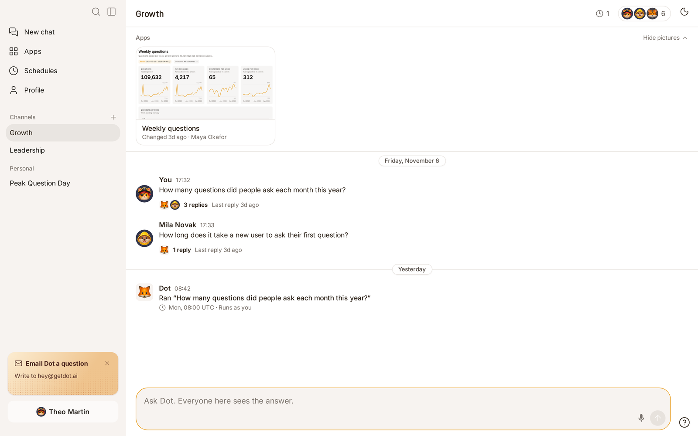
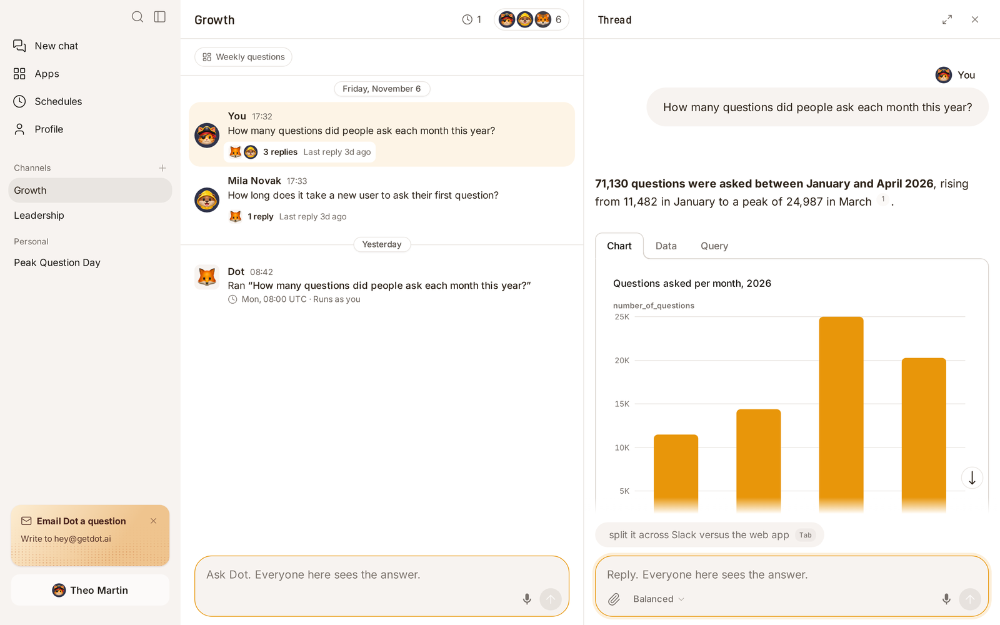
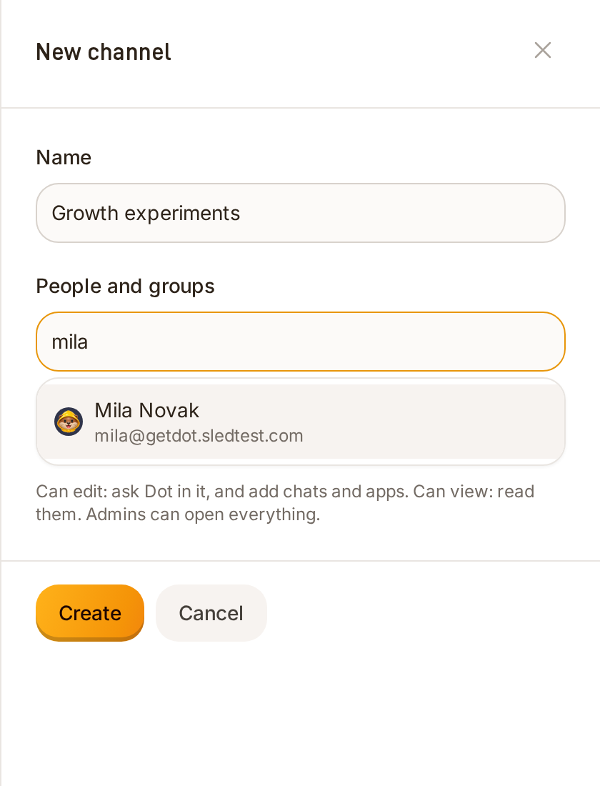
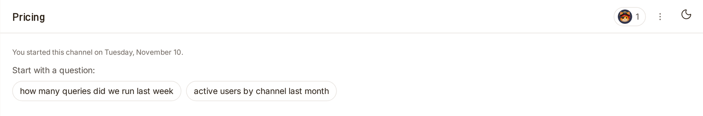
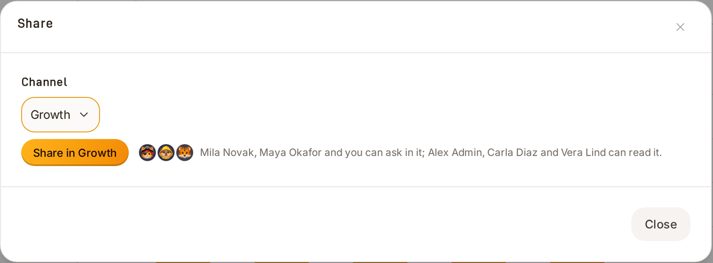
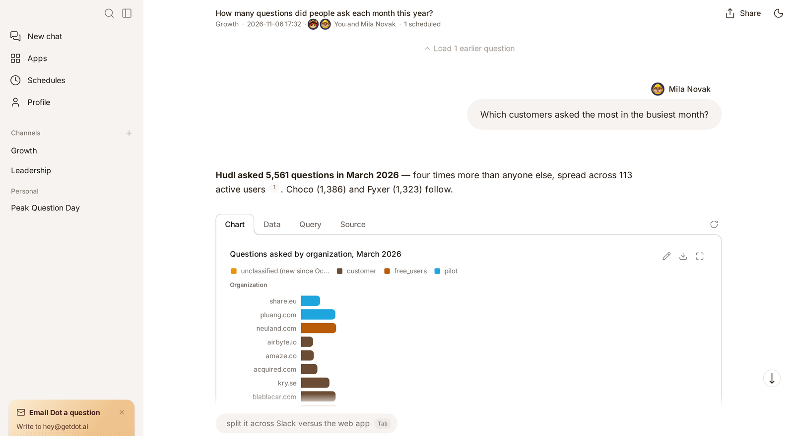
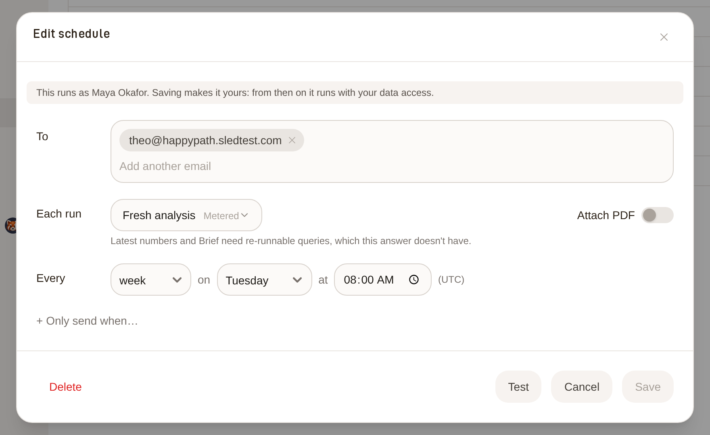
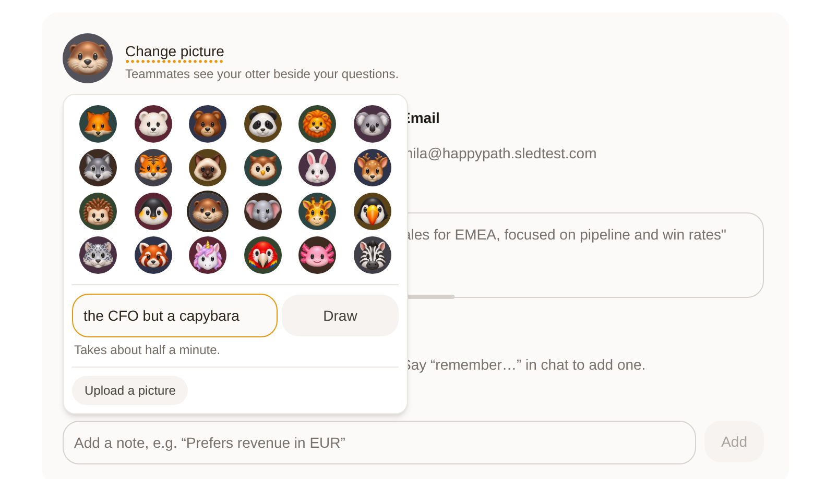

# Teams and channels

A channel is your team's place in Dot. It holds the team's questions to Dot, its apps and the schedules that deliver them. It works like a channel in Slack: the newest activity is at the bottom, and you ask Dot in the box below it.

<figure><figcaption>
A channel shows its apps, then each question with its replies.
</figcaption></figure>

## Ask Dot in a channel

1. In the sidebar, under **Channels**, open the channel.
2. Type your question in the box at the bottom and press Enter.

Your question appears in the channel, and its thread opens beside it. Dot answers in the thread, with your own data access, and everyone in the channel sees the answer. To ask a follow-up, use the box in the thread.

Each question in the channel shows who asked it and when. Below it, a line says how many replies the thread has, who replied, and when the last reply came. Click a question or its replies to open the thread. To open a thread as a page of its own, click the arrows at its top.

<figure><figcaption>
A question's thread opens beside the channel.
</figcaption></figure>

## See what is new

* A channel's name is bold in the sidebar when something happened since you last looked at it.
* In the channel, a **New** line sits above what came after your last visit.
* A gold dot on a question's replies means its thread has news you haven't opened.

## Who is in a channel

Each channel names the groups and people who can open it, and what they can do there:

* **Can edit**: ask Dot in the channel, and put chats and apps in it.
* **Can view**: read everything in the channel.

Admins open every channel. Everything that is in no channel is personal: only you and admins can open it, unless you share its link.

To see who is in a channel, click the faces at the top of it. The number beside them says how many people can open it. In a channel you can only read, the place of the box says who can let you ask. A thread says the same, and offers **Continue in a private chat**.

## Start a channel

Anyone in the workspace can start a channel.

1. In the sidebar, click **+** beside **Channels**.
2. Name the channel.
3. Add groups or people. A group joins as **Can view** and a person as **Can edit**.
4. Change **Can view** to **Can edit** for the people who should ask Dot in it.
5. Click **Create**.

A new channel is empty: it says who started it and when, and suggests a few first questions for your data. Click one to ask it.

You are always in a channel you start. You and the workspace's admins can rename it, delete it and change who is in it, from the faces and the **⋮** menu at the top of the channel. Deleting a channel gives its chats back to the people who started them. Only an admin can delete a channel that holds apps.

<figure><figcaption>
Name the channel and choose who is in it.
</figcaption></figure>

<figure><figcaption>
A new channel suggests a few first questions.
</figcaption></figure>

To find a channel, search for its name: click the magnifier at the top of the sidebar, or press ⌘K (Ctrl+K on Windows). Search also finds your teammates' questions in every channel you can open.

## Apps in a channel

A channel's apps sit at the top of it. Each card shows a picture of the app's first screen, with your own data. Click a card to open the app. **Hide pictures** turns the cards into a row of names. While a thread is open the apps show as names. On a phone they start as names; tap **Show pictures** to see the cards.

An app is in a channel when it is published to that channel's folder on the **Apps** page.

## Put a chat in a channel

In the sidebar, click **⋮** beside the chat, then **Move to a channel** and the channel. The chat leaves **Personal** and becomes a question in the channel. Its post says when it was first asked.

Or from the chat itself:

1. Open the chat and click **Share**.
2. Under **Channel**, pick the team's channel (type to search). Dot shows who will be able to ask in it and who can only read it.
3. Click **Share in** and the channel's name.

Only the person who started a chat, or an admin, can put it in a channel or take it out.

<figure><figcaption>
Share says who will ask and who will read before you share.
</figcaption></figure>

## Ask in a teammate's chat

Open a question's thread in the channel. Each question in it shows the face and name of the person who asked.

When you ask, Dot answers with your own data access, not the access of the person who started the chat. Everyone in the channel sees what you ask. To build on a teammate's analysis without adding to their chat, open it as a page and click **Continue in a private chat**. Your copy keeps who asked each earlier question.

If a teammate asks while you have the chat open, their question and Dot's work appear as they happen.

<figure><figcaption>
A team chat says which channel it is in and who asked each question.
</figcaption></figure>

## The sidebar

* **Channels** lists the channels you are in. A channel's name is bold when something is new in it since you last looked. Admins also see **All channels**, which lists every channel in the workspace, including the ones they are not in.
* **Personal** lists your chats that are in no channel. A chat in a channel is a question in that channel.

To make the sidebar wider, for long chat titles or channel names, drag its right edge.

## Schedules in a channel

The clock at the top of a channel lists the schedules that deliver its chats and apps, and whose data access each one runs with. When a schedule runs, Dot posts in the channel that it ran. Click the post to see what it sent. On the **Schedules** page your own schedules come first, then **Channels**: the schedules in the channels you are in.

* People who can edit the channel can pause and resume a teammate's schedule. It keeps running as its owner.
* Editing a teammate's schedule makes it yours. From then on it runs with your data access, and the editor says so before you save.
* People who can only view the channel see what runs and as whom, but not who receives it.

<figure><figcaption>
Saving a change to a teammate's schedule makes it yours.
</figcaption></figure>

## Your face

Teammates see your face beside your questions. To change it, open **Profile** and click your face. Then do one of these:

* Choose any of the animals.
* Describe a face in a few words, for example "a pirate cat", and click **Draw**. It takes about half a minute, and you can draw ten a day.
* Click **Upload a picture**.

Until you choose, Dot shows your Slack photo if it has one. Otherwise it shows an animal it picked for you.

<figure><figcaption>
Choose an animal, draw your own, or upload a picture.
</figcaption></figure>

## Ask Dot about your team

Dot knows the channels you can open and what is in them. You can ask it things like:

* _"Which channels am I in, and what's in Commercial?"_
* _"What has the Commercial team been looking at lately?"_
* _"Who asked the earlier questions in this chat?"_
* _"Move this chat's weekly schedule to Mondays at 9."_

Before Dot changes a teammate's schedule, it tells you the schedule will run with your access and asks you to confirm.

Dot can't publish an app for you. When you ask it to put an app in a channel, it builds the app and tells you to click **Publish** and pick the channel's folder.
