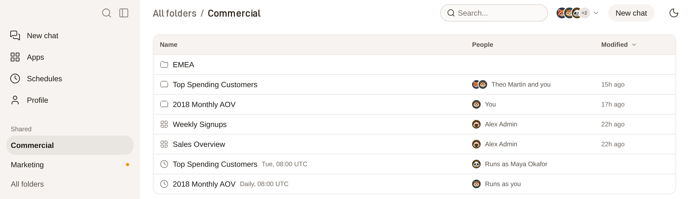
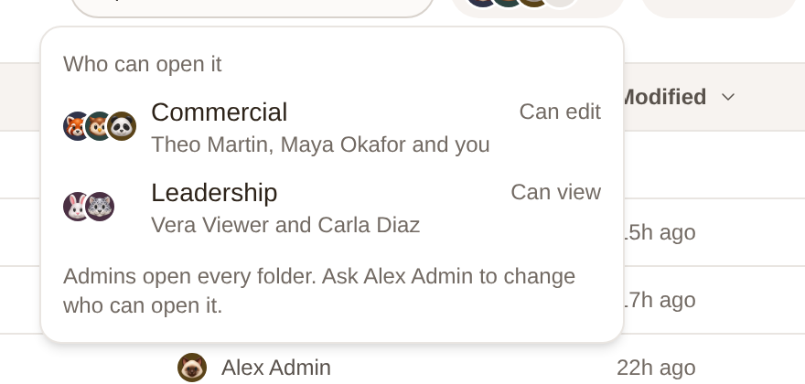
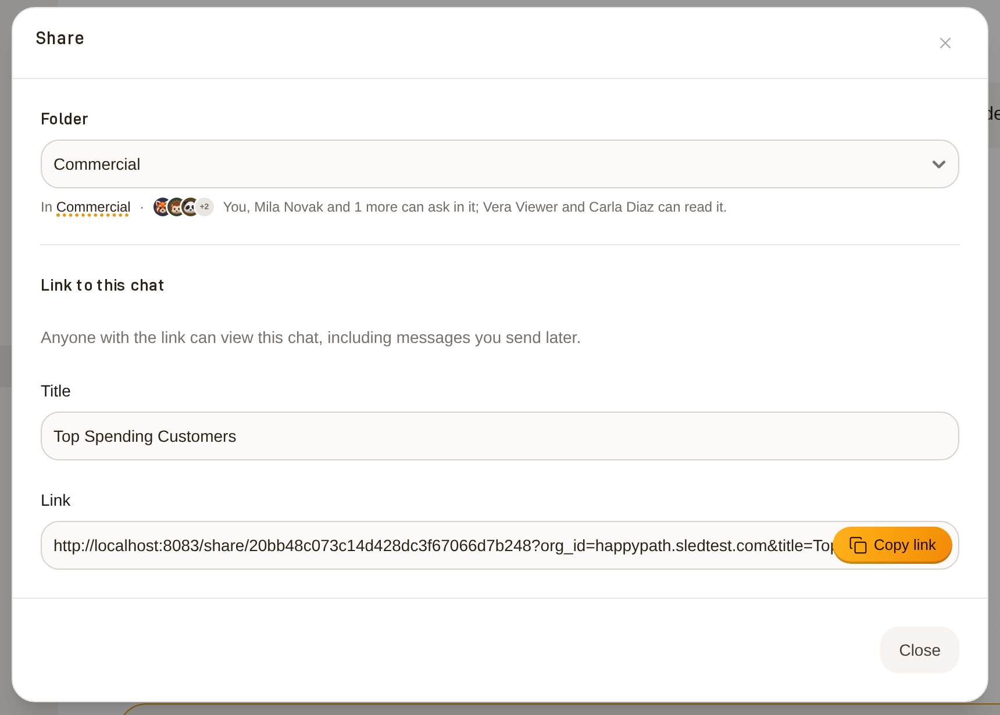

# Teams and shared folders

A shared folder is your team's place in Dot. It holds the team's chats, its apps and the schedules that deliver them. The people a folder names are the team, so there is nothing else to set up.

<figure><figcaption>
A folder lists everything the team keeps, with who is in each item.
</figcaption></figure>

## Who is in a folder

Each folder names the groups and people who can open it, and what they can do there:

* **Can edit**: put chats, apps and subfolders in the folder, and ask in its chats.
* **Can view**: read everything in the folder.

Admins open every folder. A subfolder has the same people as its parent unless you narrow it. Everything that is in no folder is personal: only you and admins can open it, unless you share its link.

To see who is in a folder, open it and click the faces at the top. The number beside them says how many people can open the folder. If you can't change who is in it, the list names an admin to ask.

<figure><figcaption>
Who can open a folder, and what each group can do there.
</figcaption></figure>

## Create a folder

Admins create a team's folder and decide who is in it. So can modelers in a workspace that lets modelers manage all apps.

1. In the sidebar, open **All folders**.
2. Click **New folder**.
3. Name it, then add groups or people. A group joins as **Can view** and a person as **Can edit**.
4. Change **Can view** to **Can edit** for the people who should ask in the folder's chats.

Anyone who can edit a folder can add a subfolder to it. Open the folder, click **New folder** and name it. The subfolder starts with the same people as the folder.

Deleting a folder deletes its apps for good. Its chats go back to the people who started them.

## Put a chat in a folder

1. Open the chat and click **Share**.
2. Under **Folder**, pick the team's folder. Dot shows who will be able to ask in it and who can only read it.
3. Click **Share with** and the folder's name.

Only the person who started a chat, or an admin, can put it in a folder. Once it is there, the folder's editors can move it to another folder they can edit, for example a subfolder.

<figure><figcaption>
Share says who will ask and who will read before you share.
</figcaption></figure>

## Ask in a teammate's chat

Open the chat from its folder or from **Recents** in the sidebar. Each question shows the face and name of the person who asked it.

When you ask, Dot answers with your own data access, not the access of the person who started the chat. Everyone in the folder sees what you ask, and the line above the message box says so. To build on a teammate's analysis without adding to their chat, click **Continue in a private chat**. Your copy keeps who asked each earlier question.

If a teammate asks while you have the chat open, their question and Dot's work appear as they happen.

People who can only view the folder read the chat, and see **Continue in a private chat** to ask their own follow-up.

<figure><figcaption>
A team chat says where it lives, who is in it and who asked each question.
</figcaption></figure>

## The sidebar

**Shared** lists the folders you are in. A dot means something in a folder is new to you. **All folders** lists every folder you can open.

**Recents** lists your chats and the team chats you opened or asked in, with the faces of the people in each.

## Schedules in a folder

A folder's page lists the schedules that deliver its chats and apps, and whose data access each one runs with (**Runs as**). On the **Schedules** page your own schedules come first, then **Shared**: the schedules in the folders you are in.

* People who can edit the folder can pause and resume a teammate's schedule. It keeps running as its owner.
* Editing a teammate's schedule makes it yours. From then on it runs with your data access, and the editor says so before you save.
* People who can only view the folder see what runs and as whom, but not who receives it.

<figure><figcaption>
Saving a change to a teammate's schedule makes it yours.
</figcaption></figure>

## Your face

Teammates see your face beside your questions. To change it, open **Profile** and click your face. Then do one of these:

* Choose any of the animals.
* Describe a face in a few words, for example "a pirate cat", and click **Draw**. It takes about half a minute, and you can draw ten a day.
* Click **Upload a picture**.

Until you choose, Dot shows your Slack photo if it has one. Otherwise it shows an animal it picked for you.

<figure><figcaption>
Choose an animal, draw your own, or upload a picture.
</figcaption></figure>

## Ask Dot about your team

Dot knows the folders you can open and what is in them. You can ask it things like:

* _"Which shared folders am I in, and what's in Commercial?"_
* _"What has the Commercial team been looking at lately?"_
* _"Who asked the earlier questions in this chat?"_
* _"Move this chat's weekly schedule to Mondays at 9."_

Before Dot changes a teammate's schedule, it tells you the schedule will run with your access and asks you to confirm.

Dot can't publish an app for you. When you ask it to put an app in a folder, it builds the app and tells you to click **Publish** and pick the folder.
