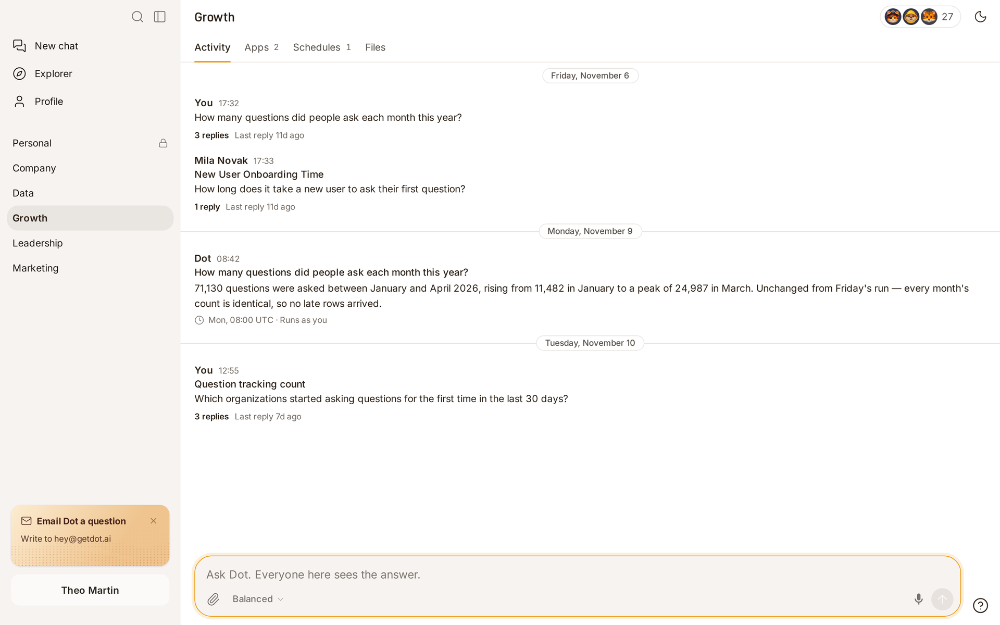
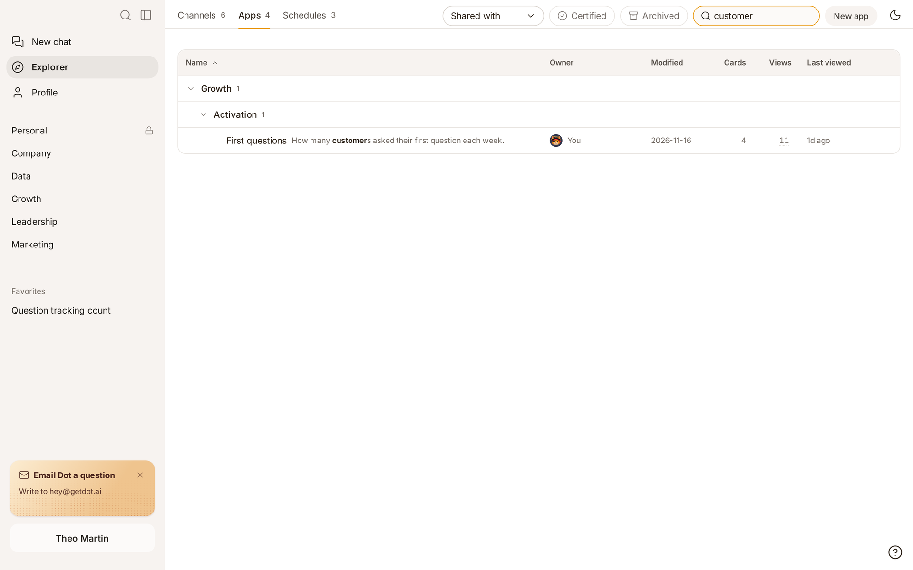
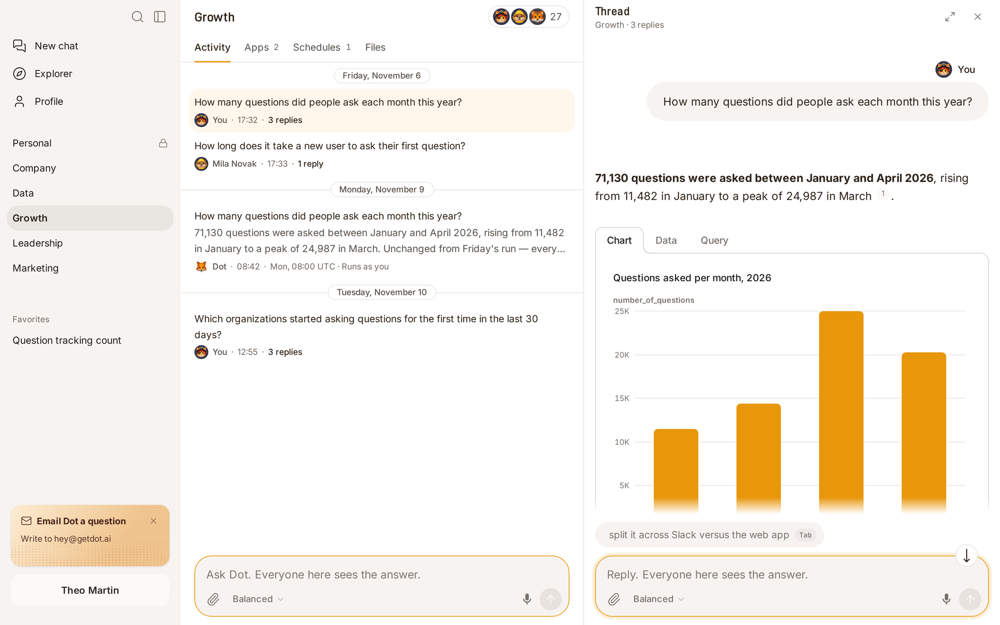
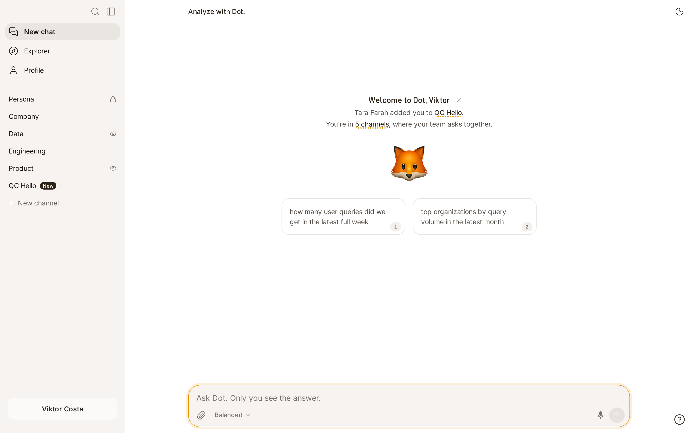
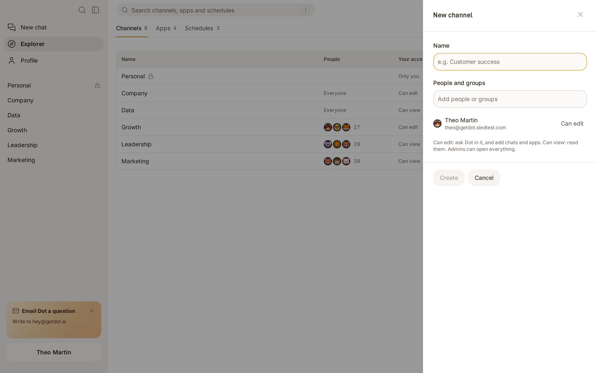
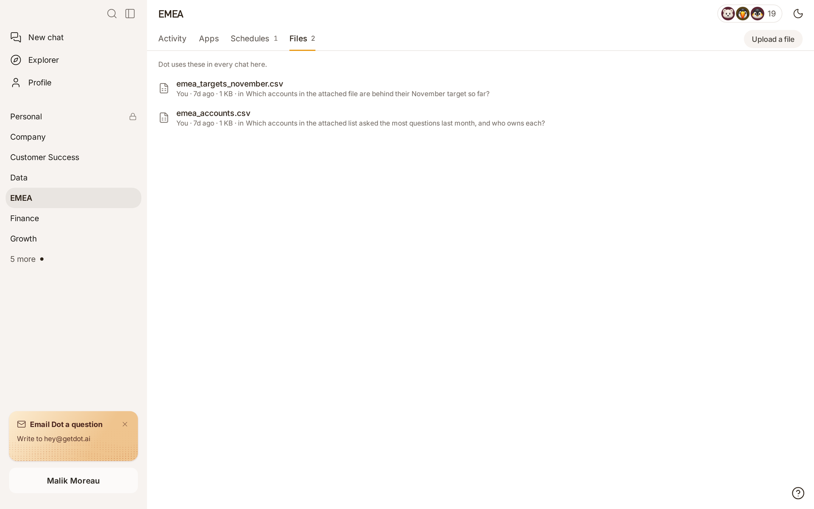
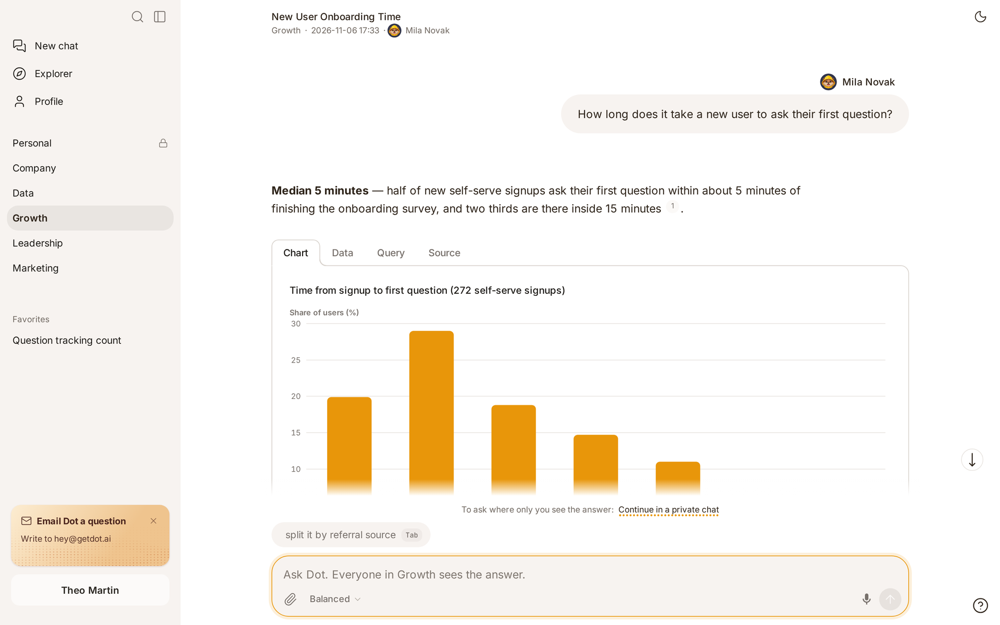
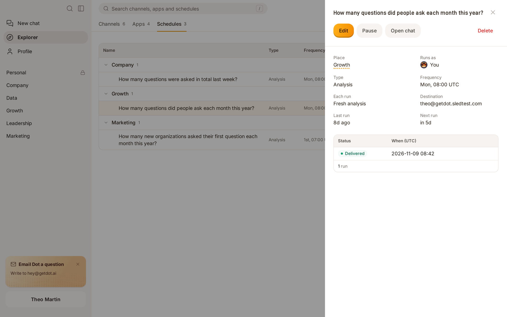

# Teams and channels

Everything in Dot lives in one place. A place is **Personal**, where only you see it, or a **channel**, your team's place. Each place holds its chats, apps and schedules, each on its own tab: **Activity**, **Apps** and **Schedules**, plus **Files** in a channel.

The sidebar lists your places: **Personal** first, then your channels. A dot beside a place means something is new there since you last looked. To see everything you can open at once, click **Explorer**.

<figure><figcaption>
A channel's activity: each question with its replies, and what a schedule found.
</figcaption></figure>

## Find anything in the Explorer

The Explorer lists every place you can open on its **Channels** tab, every app on **Apps** and every schedule on **Schedules**, grouped by place. On **Channels** you see who is in each channel, your access, what it holds and when it last changed. Point at a row to see its newest post.

To find something:

1. In the sidebar, click **Explorer**, then the tab for what you are looking for.
2. Type in the tab's search, at the right end of the tabs. You can also press **/** to jump to it.

A channel or folder you find by its name shows everything in it, and an app is found by its description too. Press **Escape** to clear the search. To find anything at once, from any page, use the search at the top of the sidebar (⌘K, or Ctrl+K on Windows).

<figure><figcaption>
Each tab has its own search.
</figcaption></figure>

Admins see the same page with more on it: every channel in the workspace, and other people's personal apps and schedules.

## Personal

**Personal** holds your chats that are in no channel, and your own apps and schedules. Only you and admins can open it, unless you share a chat's link. If your admin lets modelers read every chat in History, modelers can open it too.

To ask Dot something only you see, open **Personal** and type in the box at the bottom. Click one of your chats there to open it beside the list, as a thread opens in a channel.

## Ask Dot in a channel

1. In the sidebar, click the channel.
2. Type your question in the box at the bottom of **Activity** and press Enter.

Your question appears in the channel, and its thread opens beside it. Dot answers in the thread, with your own data access, and everyone in the channel sees the answer. To ask a follow-up, use the box in the thread.

Each question in the channel shows what was asked, and under it who asked, when, and how many replies its thread has. Click a question to open its thread. To open a thread as a page of its own, click the arrows at its top.

<figure><figcaption>
A question's thread opens beside the channel.
</figcaption></figure>

## See what is new

* A dot beside a channel in the sidebar and in the Explorer means something happened there since you last looked.
* In the channel, a **New** line sits above what came after your last visit.
* A dot on a question's replies means its thread has news you haven't opened.
* **New** beside a channel means someone added you to it. See [When someone adds you](#when-someone-adds-you).

## Who is in a channel

Each channel names the groups and people who can open it, and what they can do there:

* **Can edit**: ask Dot in the channel, and put chats and apps in it.
* **Can view**: read everything in the channel.

Admins open every channel.

To see who is in a channel, click the faces at the top of it. The number beside them says how many people can open it. If you are in it through a group, that group's row names you among its people.

In a channel you can only read, the place of the box says so and who can let you ask. A thread says the same, and offers **Continue in a private chat**.

## When someone adds you

When someone adds you to a channel, Dot tells you:

* The channel shows **New** in the sidebar until you open it. Point at **New** to see who added you.
* **New chat** says who added you, with a link to the channel.
* If they added you by name, not through a group, you also get an email with a link to the channel.

The channel's first line says who started it and how you came in, for example "Tara Farah started this channel today and added you." Its activity also shows who was added and removed since.

<figure><figcaption>
A first visit says who added you, and where.
</figcaption></figure>

## Start a channel

Anyone in the workspace can start a channel.

1. In the **Explorer**, on the **Channels** tab, click **New channel**. You can also click **New channel** under your places in the sidebar. Once you have started a channel, it shows there when you point at the list.
2. Name the channel.
3. Add groups or people. A group joins as **Can view** and a person as **Can edit**.
4. Change **Can view** to **Can edit** for the people who should ask Dot in it.
5. Click **Create**.

A new channel says who started it, when and with whom, and suggests a few first questions for your data. Click one to ask it.

You are always in a channel you start. You and the workspace's admins manage it:

* To add or remove people, click the faces at the top of the channel, then **Add or remove people**. The channel's activity shows each change.
* To rename or delete it, click **⋮** at the top of the channel.

Deleting a channel gives its chats back to the people who started them. Replies teammates asked in those chats go with them, and Dot names whose before you delete. Only an admin can delete a channel that holds apps.

<figure><figcaption>
Name the channel and choose who is in it.
</figcaption></figure>

To find a channel, search for its name in the Explorer, or click the magnifier at the top of the sidebar or press ⌘K (Ctrl+K on Windows). That search also finds your teammates' questions in every channel you can open.

## Apps in a channel

The **Apps** tab lists the channel's apps, and the folders in it. Point at an app's name to see a picture of it, with your own data. Click the name to open the app.

To put an app in a channel, click **Publish** in the app's chat and pick the channel. To move an app you already published, click **⋮** at the end of its row, then **Move to…** and the place.

Admins sort a channel's apps into folders. Click **New folder** on the channel's **Apps** tab and type the name. In the Explorer's **Apps** tab, **New folder** first asks which channel, or which folder in one, it goes in.

## Files in a channel

The **Files** tab lists every file uploaded in the channel's chats: who gave it, when, and the chat it came with. Click a file to download it, or its chat to open the thread.

To add a file, attach it to your question in the box at the bottom of **Activity**, or click **Upload a file**. Dot uses the channel's files as context. When you ask in any of the channel's chats, Dot knows which files the team has given it and brings in the one your question needs, so nobody has to upload the same file twice.

<figure><figcaption>
The Files tab lists what the channel's chats were given.
</figcaption></figure>


Uploaded files follow your workspace's **Data retention** setting, so a file leaves the list when it expires.


## Put a chat in a channel

1. Click **⋮** on the chat: on its post in **Personal**, on its row in your favorites, or beside **Share** on the chat's own page.
2. Click **Move to…** and pick the channel.

The chat leaves **Personal** and becomes a question in the channel. Its post says when it was first asked. To move it back, pick **Personal** the same way.

You can also click **Share**: at the top of the chat's page, or at the top of its thread beside a channel or **Personal**. Click the place under **Shown in**, pick the channel, and click **Share in** and the channel's name. Dot shows who will be able to ask in it and who can only read it before you share. **Copy link** in the same window copies a link to the chat.

Only the person who started a chat, or an admin, can put it in a channel or take it out. Once a teammate has asked in it, it stays in that channel: their answers came from their own data access, for that channel's people. You can still take it out of the team, and an admin can move it.

## Ask in a teammate's chat

Open a question's thread in the channel. Each question in it shows the face and name of the person who asked.

When you ask, Dot answers with your own data access, not the access of the person who started the chat. Everyone in the channel sees what you ask. Dot reads your teammates' questions and answers in the chat, but never the data they fetched along the way, and when you download a table from a teammate's answer, Dot fetches it again with your own access. To build on a teammate's analysis without adding to their chat, click **Continue in a private chat** in its thread. Your copy keeps who asked each earlier question. Dot builds apps only in your own chats: ask for a dashboard in a teammate's chat, and Dot sends you to **Continue in a private chat**.

If a teammate asks while you have the chat open, their question and Dot's work appear as they happen.

<figure><figcaption>
A team chat says which channel it is in and who asked each question.
</figcaption></figure>

## Schedules in a channel

The **Schedules** tab lists the schedules that deliver the channel's chats and apps: how often each runs, whose data access it runs with, and when it runs next. Click one of your schedules to see its place, who it runs as and its past runs; a teammate's schedule opens its thread in the channel. When a schedule runs, Dot posts what it found in the channel. Click the post to read everything it sent, beside the channel.

* People who can edit the channel can pause and resume a teammate's schedule from the **⋮** at the end of its row. It keeps running as its owner.
* Editing a teammate's schedule makes it yours. From then on it runs with your data access, and the editor says so before you save.
* To test a teammate's schedule, choose **Latest numbers** or **Brief**: the test runs with your own data access.
* People who can only view the channel see what runs and as whom, but not who receives it.

<figure><figcaption>
A schedule says which place it belongs to and whose access it runs with.
</figcaption></figure>

## Your face

Teammates see your face beside your questions. To change it, open **Profile** and click your face. Then do one of these:

* Choose any of the animals.
* Describe a face in a few words, for example "a pirate cat", and click **Draw**. It takes about half a minute, and you can draw ten a day.
* Click **Upload a picture**.

Until you choose, Dot shows your Slack photo if it has one. Otherwise it shows an animal it picked for you.

## Ask Dot about your team

Dot knows the channels you can open and what is in them. You can ask it things like:

* _"Which channels am I in, and what's in Commercial?"_
* _"What has the Commercial team been looking at lately?"_
* _"Who asked the earlier questions in this chat?"_
* _"Move this chat's weekly schedule to Mondays at 9."_

Before Dot changes a teammate's schedule, it tells you the schedule will run with your access and asks you to confirm.

Dot can't publish an app for you. When you ask it to put an app in a channel, it builds the app and tells you to click **Publish** and pick the channel.
