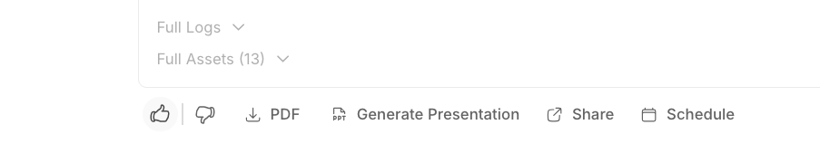
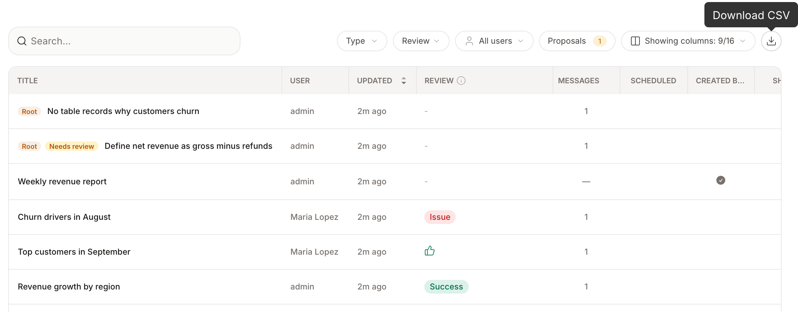

# User Feedback

Users can either upvote or downvote a response from Dot. This feedback tells admins where Dot's knowledge base needs work.

## Negative feedback

👎 is the signal worth acting on. Dot learns from being corrected far more than from being approved of: a downvote, ideally with a sentence about what the right answer was, tells an admin exactly which definition, table, or note is missing or wrong.

<figure><figcaption>
Users rate an answer with 👍 or 👎
</figcaption></figure>

## Positive Feedback

👍 marks an answer as good. It is a light-touch signal — useful for seeing which topics are working, but it does not by itself change how Dot answers in the future.

## Admin Overview

Admins can see the history of all users on the **History** page. Its **Review** column shows what users clicked: a thumbs down when a conversation has at least one dislike, and a thumbs up when it has only likes.

The same column shows Dot's own review of each conversation, such as **Issue** or **Success**. Dot reviews its answers in the background whether or not anyone clicks anything. See [Maintaining Dot](maintaining-dot.md) for how to work through both signals.

Click **Download CSV**, the download icon at the end of the filter bar, to save every chat that matches your search, filters and dates as a CSV file. You can get the same file [over the API](api/commonly-used-endpoints.md#export-conversation-history).

<figure><figcaption>
The Review column and Download CSV in History
</figcaption></figure>
