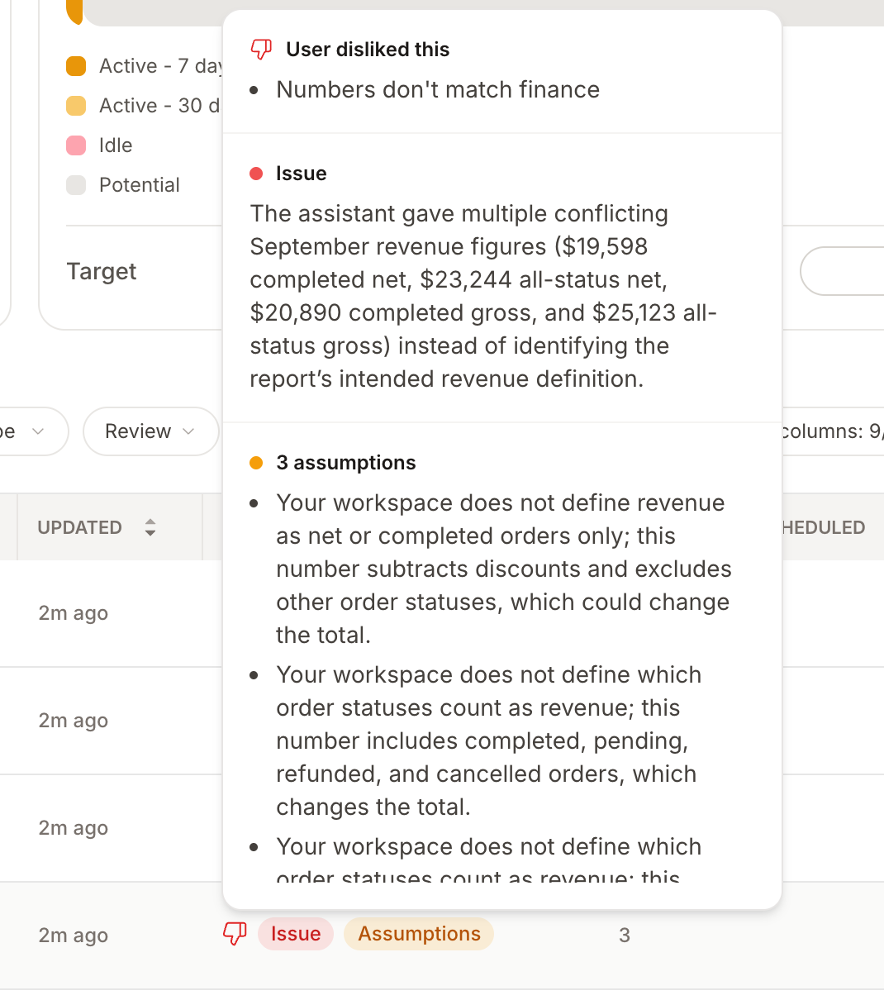

# User Feedback

Users can either upvote or downvote a response from Dot. This feedback tells admins where Dot's knowledge base needs work.

## Negative feedback

👎 is the signal worth acting on. Dot learns from being corrected far more than from being approved of: a downvote, ideally with a sentence about what the right answer was, tells an admin exactly which definition, table, or note is missing or wrong.

<figure><figcaption>
Users rate an answer with 👍 or 👎
</figcaption></figure>

## Positive Feedback

👍 marks an answer as good. It is a light-touch signal — useful for seeing which topics are working, but it does not by itself change how Dot answers in the future.

## Admin Overview

Admins can see the history of all users on the **History** page. Its **Review** column shows a thumb when users rated an answer in the conversation, next to Dot's own checks: **Issue**, **Success** and **Assumptions**. Dot reviews its answers in the background whether or not anyone clicks anything.

Hover a row's review to see which answers were liked or disliked and when, why Dot flagged the conversation, and the assumptions it made. Click an item to open the chat at that answer. Use the **Review** filter to narrow the list to Liked, Disliked, Issue, Assumptions, Success or Unanswered. See [Maintaining Dot](maintaining-dot.md) for how to work through these signals.

To see only chats that built or edited an app, pick **App building** under **Type**. To get these chats as a CSV file, use the [API](api/commonly-used-endpoints.md#export-conversation-history).

<figure><figcaption>
Hover a Review cell in History to see the rating, Dot's verdict and its assumptions
</figcaption></figure>
